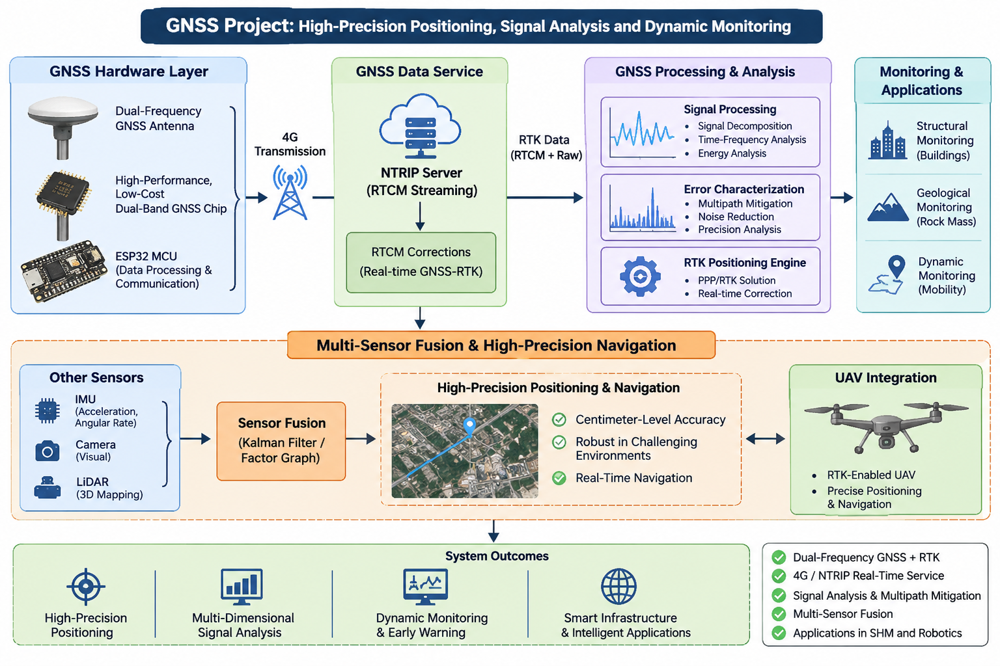

## Overview

**Low-Cost Dual-Frequency GNSS | RTK Positioning | Signal Intelligence | Dynamic Monitoring | Multi-Sensor Fusion**

An integrated GNSS engineering and research platform for high-precision positioning, signal processing, dynamic monitoring, and multi-sensor navigation. The system integrates low-cost dual-frequency GNSS hardware, embedded computing, wireless communication, RTK correction services, advanced signal analysis, and sensor fusion for engineering and geospatial applications.

## System Architecture



The system integrates GNSS hardware development, wireless communication, real-time positioning, signal intelligence, dynamic monitoring, and multi-sensor navigation into a unified framework.

## Hardware Development

### GNSS Hardware

- High-performance, low-cost dual-frequency GNSS receiver
- GNSS antenna and receiver integration
- ESP32 MCU for embedded control and data acquisition
- 4G communication module for wireless connectivity
- IMU integration for motion sensing
- Hardware–software integration and prototyping

### Embedded System Development

- GNSS data acquisition
- Embedded firmware development
- Sensor interfacing
- Communication protocols
- Data transmission and system control
- Low-cost hardware integration

## Communication & GNSS-RTK Infrastructure

Development of a wireless GNSS communication and real-time correction framework.

- 4G wireless communication
- NTRIP client/server infrastructure
- RTCM correction data transmission
- GNSS base–rover configuration
- Real-time kinematic (RTK) positioning
- Remote data acquisition and monitoring

### System Workflow

```text
GNSS Reference Station
        │
        ▼
RTCM Correction Data
        │
        ▼
NTRIP Caster / Server
        │
        ▼
4G Communication
        │
        ▼
GNSS Rover
        │
        ▼
Real-Time GNSS-RTK Positioning
```

## GNSS Signal Processing & Intelligence

Advanced GNSS signal analysis for positioning performance evaluation, environmental characterisation, and dynamic monitoring.

### Signal Processing Techniques

- GNSS signal decomposition
- Time-domain analysis
- Frequency-domain analysis
- Time-frequency analysis
- Signal energy analysis
- Noise characterisation
- Multipath analysis and mitigation
- GNSS measurement error analysis

### Multi-Dimensional Signal Analysis

| Analysis Domain | Research Focus |
|---|---|
| Time Domain | Temporal variations, dynamic response and signal trends |
| Frequency Domain | Frequency components, spectral characteristics and periodic behaviour |
| Time-Frequency Domain | Non-stationary signal behaviour and evolving frequency characteristics |
| Energy Domain | Signal energy variations and anomaly-related features |
| Spatial Domain | Position, displacement, trajectory and spatial deformation |

Combining multi-dimensional signal analysis provides a comprehensive framework for investigating GNSS measurement characteristics, dynamic signal behaviour, environmental effects, and monitoring-related anomalies.

## High-Precision Positioning & Error Characterisation

Development and evaluation of GNSS positioning solutions under static and dynamic conditions.

### Research & Engineering Focus

- Dual-frequency GNSS positioning
- GNSS-RTK positioning
- Positioning accuracy and precision evaluation
- Measurement noise analysis
- Multipath error characterisation and mitigation
- Environmental effects on GNSS observations
- Positioning stability and reliability
- Dynamic positioning performance

### Positioning Performance Evaluation

- Horizontal and vertical positioning errors
- Positioning precision and repeatability
- RTK solution status and availability
- Satellite geometry and observation quality
- Error time series and spectral characteristics
- Dynamic trajectory accuracy

## Dynamic Monitoring Applications

Application of GNSS positioning and signal analysis to infrastructure and geotechnical monitoring.

### Structural Monitoring

- Structural displacement monitoring
- Dynamic response analysis
- GNSS time-series characterisation
- Frequency-domain analysis
- Abnormal movement detection
- Long-term structural behaviour assessment

### Geological & Rock-Mass Monitoring

- Surface deformation monitoring
- Rock-mass displacement analysis
- Dynamic deformation characterisation
- Environmental signal analysis
- Multi-dimensional signal processing
- Potential abnormal deformation identification

### Monitoring Workflow

```text
GNSS Observations
        │
        ▼
Positioning & Coordinate Estimation
        │
        ▼
Displacement Time Series
        │
        ├── Time-Domain Analysis
        ├── Frequency-Domain Analysis
        ├── Time-Frequency Analysis
        └── Energy Analysis
                    │
                    ▼
       Dynamic Behaviour Characterisation
                    │
                    ▼
      Monitoring & Anomaly Assessment
```

## Multi-Sensor Fusion & Navigation

Integration of GNSS with complementary sensors for high-precision positioning, navigation, and environmental perception.

### GNSS–IMU Integration

- GNSS and IMU integration
- Multi-sensor data synchronisation
- Position, velocity and attitude estimation
- Continuous navigation
- Robust positioning in challenging environments
- Sensor fusion and trajectory estimation

### UAV-Based Positioning & Navigation

- RTK-enabled UAV positioning
- High-precision trajectory estimation
- GNSS–IMU integration
- UAV navigation
- Mobile surveying and mapping
- Geospatial data acquisition

## Technology Stack

### Hardware & Embedded Systems

- Dual-frequency GNSS receivers
- GNSS antennas
- ESP32 microcontrollers
- IMU sensors
- 4G communication modules
- UAV platforms

### GNSS & Positioning

- GNSS / GPS / Multi-GNSS
- Dual-frequency positioning
- RTK
- NTRIP
- RTCM
- Positioning error analysis

### Signal Processing & Analysis

- Signal decomposition
- Time-domain analysis
- Frequency-domain analysis
- Time-frequency analysis
- Energy analysis
- Multipath characterisation
- Noise analysis

### Software & System Integration

- Embedded development
- Data acquisition
- Communication protocols
- Python-based data processing
- Sensor integration
- Data visualisation
- Monitoring applications

## System Development Workflow

```text
Hardware Design & Integration
             │
             ▼
GNSS Data Acquisition
             │
             ▼
Embedded Processing & Communication
             │
             ▼
NTRIP / RTCM Correction Infrastructure
             │
             ▼
GNSS-RTK Positioning
             │
             ▼
Signal Processing & Error Analysis
             │
             ▼
Multi-Dimensional Signal Intelligence
             │
             ▼
Dynamic Monitoring & Sensor Fusion
             │
             ▼
Engineering Applications
```

## Applications

| Application | GNSS Technology |
|---|---|
| Structural Health Monitoring | Displacement and dynamic response monitoring |
| Geological Monitoring | Rock-mass deformation and geohazard monitoring |
| Precision Surveying | High-precision GNSS positioning |
| UAV Navigation | RTK positioning and sensor integration |
| Mobile Mapping | GNSS–IMU integration and trajectory estimation |
| Intelligent Infrastructure | Distributed sensing and remote monitoring |

## Project Highlights

- **Hardware-to-Software Integration:** Development of an integrated GNSS system spanning receiver hardware, embedded computing, communication, and data processing.
- **Low-Cost High-Precision Positioning:** Dual-frequency GNSS hardware integrated with RTK correction infrastructure.
- **Signal Intelligence:** Multi-dimensional GNSS signal analysis incorporating time, frequency, time-frequency, and energy characteristics.
- **Error Characterisation:** GNSS measurement error analysis, environmental assessment, and multipath mitigation.
- **Dynamic Monitoring:** Application of GNSS signal processing and positioning to structural and geological monitoring.
- **Multi-Sensor Integration:** Integration of GNSS with IMU and UAV platforms for high-precision positioning and navigation.

## Project Status

This repository documents the development of a GNSS integrated sensing, positioning, and signal analysis platform, including hardware prototypes, software modules, signal processing workflows, system integration, and application demonstrations.

Individual components are under continuous development and validation.

## Research Interests

`GNSS` · `RTK` · `Geodesy` · `Signal Processing` · `Time-Frequency Analysis` · `Multipath Mitigation` · `Structural Health Monitoring` · `Dynamic Monitoring` · `Sensor Fusion` · `Robotics` · `UAV Navigation` · `Cyber-Physical Systems`
