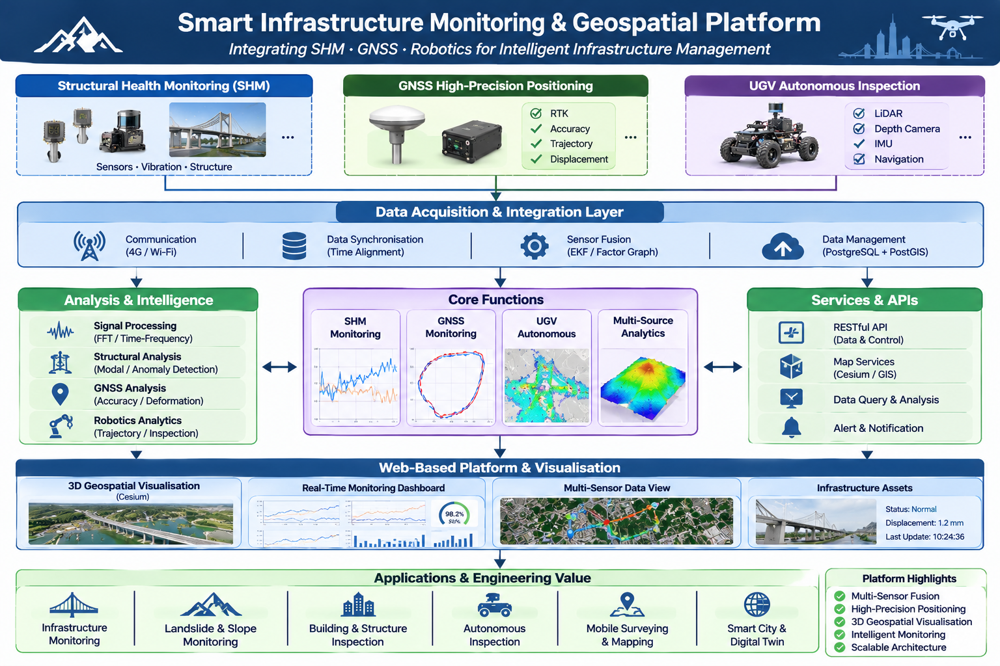
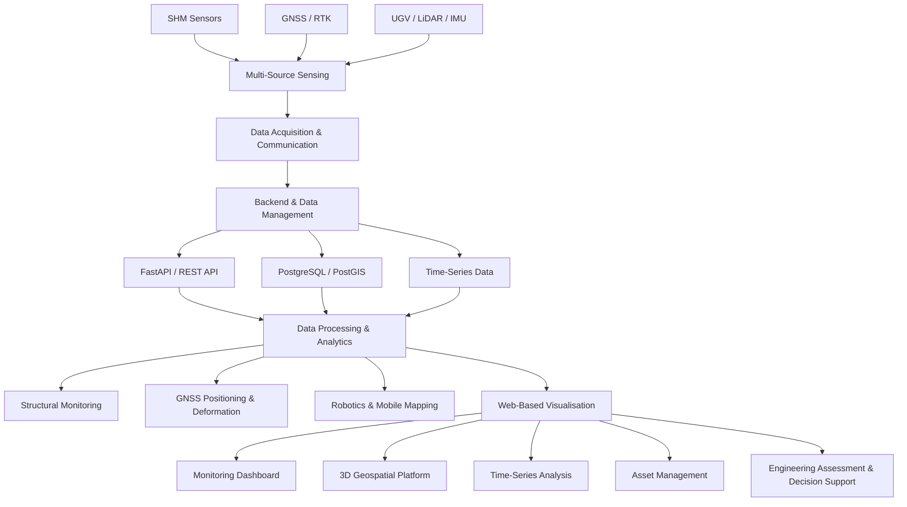

## Overview

**Structural Health Monitoring | GNSS Positioning | Robotics | Geospatial Visualisation | Data Analytics**

An integrated digital platform for infrastructure monitoring, high-precision geospatial positioning, robotic inspection, and engineering data visualisation.

The platform aims to connect structural health monitoring (SHM), GNSS positioning, and autonomous robotic systems within a unified software environment, enabling the acquisition, management, processing, visualisation, and analysis of multi-source engineering data.

Combining web-based technologies, geospatial visualisation, database management, sensor data processing, and engineering analytics, the platform provides a foundation for intelligent infrastructure monitoring, deformation assessment, mobile surveying, and digital engineering applications.

## Platform Overview

The platform is designed to integrate three major engineering domains:

- **Structural Health Monitoring (SHM)** – structural sensors, vibration monitoring, dynamic response, modal analysis, and condition assessment.
- **GNSS & Geospatial Monitoring** – high-precision positioning, displacement analysis, trajectory monitoring, deformation assessment, and geospatial visualisation.
- **UGV & Robotic Inspection** – autonomous inspection, robotic localisation, mobile mapping, and spatial data acquisition.

The integrated platform provides a unified interface for monitoring assets, sensor data, spatial information, and engineering analysis.

## System Architecture



### Platform Architecture



## Core Modules

### 1. Geospatial Visualisation Platform

Interactive geospatial visualisation and spatial data management using Cesium.

#### Features

- 3D geospatial visualisation
- Interactive map navigation
- Infrastructure asset visualisation
- Sensor location management
- Spatial data integration
- GNSS positioning and trajectory visualisation
- Monitoring site and asset representation
- Geospatial information management

#### Technology

- Cesium
- Vue 3
- JavaScript
- Geospatial data visualisation

---

### 2. Structural Health Monitoring (SHM)

Integration of structural sensors, monitoring data, and engineering analysis for infrastructure condition monitoring.

#### Monitoring Capabilities

- Structural sensor data acquisition
- Accelerometer and IMU data visualisation
- Structural vibration monitoring
- Time-domain analysis
- Frequency-domain analysis
- FFT and spectral analysis
- Structural modal identification
- Abnormal vibration detection
- Structural condition assessment

#### Potential Applications

- Bridges
- Buildings
- High-mast structures
- Industrial infrastructure
- Civil engineering structures

---

### 3. GNSS Positioning & Geospatial Monitoring

Integration of GNSS positioning data and geospatial analysis for high-precision monitoring and deformation assessment.

#### GNSS Data & Positioning

- GNSS positioning data management
- RTK positioning integration
- Positioning accuracy assessment
- Coordinate and positioning error analysis
- Positioning time-series visualisation
- Trajectory visualisation
- GNSS data quality assessment

#### Displacement & Deformation Monitoring

- Absolute displacement monitoring
- Relative displacement analysis
- Horizontal and vertical displacement
- Positioning error characterisation
- Long-term deformation trends
- Time-series analysis
- Dynamic displacement analysis

#### Engineering Applications

**Building Monitoring**

- Building displacement monitoring
- Structural movement assessment
- Settlement monitoring
- Long-term deformation analysis

**Geological & Landslide Monitoring**

- Slope displacement monitoring
- Landslide deformation analysis
- Surface movement monitoring
- Horizontal and vertical displacement tracking
- Potential abnormal deformation identification

**Ground Settlement Monitoring**

- Ground subsidence analysis
- Settlement time-series monitoring
- Spatial deformation visualisation
- Infrastructure settlement assessment

**Trajectory & Positioning Applications**

- GNSS trajectory visualisation
- Mobile positioning
- Positioning accuracy assessment
- Geospatial trajectory analysis
- Surveying and mapping applications

---

### 4. UGV & Robotic Inspection

Integration of autonomous ground vehicles and mobile sensing systems for inspection and spatial data acquisition.

#### Robotic Monitoring

- UGV location and trajectory visualisation
- Robot localisation information
- GNSS-RTK integration
- IMU and wheel odometry integration
- LiDAR-based environmental perception
- Robot spatial information management

#### Autonomous Inspection

- Inspection route visualisation
- Inspection waypoint management
- Mobile inspection data acquisition
- Spatially referenced inspection information
- Infrastructure inspection records

#### Mobile Surveying

- Mobile positioning and trajectory
- GNSS-RTK positioning integration
- LiDAR-based spatial mapping
- Mobile spatial data acquisition
- Geospatial data visualisation
- Integration of mobile sensing with infrastructure assets

---

### 5. Sensor Data Management & Visualisation

A unified interface for accessing, managing, and visualising multi-source sensor and monitoring data.

#### Data Management

- Sensor metadata management
- Infrastructure asset information
- Monitoring site information
- Sensor identification and configuration
- Monitoring data query
- Historical data access
- Database integration

#### Data Visualisation

- Time-series charts
- Interactive monitoring dashboards
- Sensor data tables
- Multi-channel signal visualisation
- GNSS trajectory visualisation
- Spatial data visualisation
- Monitoring data comparison

#### Supported Data Types

| Data Type | Application |
|---|---|
| Acceleration | Structural vibration monitoring |
| Angular Velocity | IMU motion analysis |
| GNSS Coordinates | High-precision positioning |
| Displacement | Structural and geotechnical monitoring |
| Trajectory | GNSS and robotic navigation |
| Point Clouds | LiDAR-based spatial mapping |
| Sensor Metadata | Sensor and asset management |

---

### 6. Data Processing & Engineering Analytics

Integration of signal processing and engineering analysis modules into a web-based monitoring platform.

#### Signal Processing

- Time-domain analysis
- Frequency-domain analysis
- FFT
- Spectral analysis
- Signal filtering
- Noise analysis
- Time-frequency analysis
- Signal decomposition

#### Structural Analysis

- Natural frequency identification
- Structural modal identification
- Dynamic response characterisation
- Vibration analysis
- Structural behaviour assessment

#### GNSS Analysis

- Positioning precision evaluation
- GNSS error analysis
- Displacement time-series analysis
- Trajectory analysis
- Deformation characterisation
- Positioning anomaly detection

#### Intelligent Monitoring

- Automated anomaly detection
- Abnormal displacement identification
- Vibration anomaly detection
- Trend analysis
- Condition assessment
- Automated monitoring reports

---

## Technology Stack

### Frontend

- Vue 3
- JavaScript
- Cesium
- ECharts
- Vite

### Backend

- Python
- FastAPI
- REST API
- Data processing services

### Database

- PostgreSQL
- PostGIS
- Time-series data management

### Geospatial Technologies

- Cesium
- GNSS
- RTK
- Geospatial data visualisation
- Coordinate transformation

### Engineering Data & Analytics

- Sensor data processing
- Signal processing
- FFT
- GNSS positioning analysis
- Structural monitoring
- Deformation analysis

---

## System Workflow

```text
Infrastructure Assets & Monitoring Sites
                    │
                    ▼
       Multi-Source Sensor Integration
                    │
       ┌────────────┼────────────┐
       ▼            ▼            ▼
      SHM         GNSS          UGV
    Sensors       RTK        Mobile Sensors
       │            │            │
       └────────────┼────────────┘
                    ▼
          Data Acquisition Layer
                    │
                    ▼
          Backend & Data Services
                    │
          ┌─────────┼──────────┐
          ▼         ▼          ▼
       Database    APIs    Processing
          │         │          │
          └─────────┼──────────┘
                    ▼
         Monitoring & Visualisation
                    │
       ┌────────────┼────────────┐
       ▼            ▼            ▼
    Dashboard    3D GIS      Analytics
       │            │            │
       └────────────┼────────────┘
                    ▼
       Engineering Assessment
                    │
                    ▼
       Monitoring & Decision Support
```

## Development Status

This project is under active development.

### Current Development

- Platform architecture and frontend navigation
- Vue-based web application development
- Cesium-based geospatial visualisation
- Backend API development using FastAPI
- PostgreSQL database integration
- IMU monitoring data access and visualisation
- Time-series data querying and presentation
- Integration of infrastructure assets and sensor information
- Initial monitoring dashboard development

### Ongoing Development

- Modular platform architecture
- Sensor data management
- Monitoring data visualisation
- Database and API integration
- Geospatial asset representation
- Integration of SHM, GNSS, and UGV data

### Future Development

- Real-time monitoring dashboards
- Sensor and asset lifecycle management
- GNSS positioning accuracy and error analysis
- GNSS trajectory and displacement visualisation
- Absolute displacement monitoring
- Building deformation and settlement monitoring
- Landslide and slope deformation monitoring
- GNSS-based structural and geotechnical monitoring
- UGV autonomous inspection
- UGV mobile surveying and mapping
- Multi-sensor data integration
- Advanced signal processing
- Structural modal identification
- Automated anomaly detection
- Structural health assessment
- Automated engineering reporting
- Digital infrastructure monitoring

## Applications

| Domain | Platform Capabilities |
|---|---|
| Structural Health Monitoring | Sensor data, vibration analysis, modal identification, condition assessment |
| GNSS Monitoring | Positioning, trajectory, accuracy and error analysis |
| Building Monitoring | Displacement and settlement monitoring |
| Geotechnical Monitoring | Landslide, slope and ground deformation |
| Autonomous Inspection | UGV monitoring and inspection |
| Mobile Surveying | GNSS-RTK, LiDAR and spatial data acquisition |
| Digital Infrastructure | Geospatial visualisation and integrated asset monitoring |

## Project Highlights

- **Integrated Engineering Platform:** Unified software environment for SHM, GNSS, robotics, and geospatial applications.
- **Full-Stack Development:** Frontend, backend, API, database, and visualisation integration.
- **3D Geospatial Visualisation:** Interactive Cesium-based spatial platform for infrastructure and monitoring assets.
- **Sensor Data Integration:** Access, management, and visualisation of multi-source monitoring data.
- **GNSS Deformation Monitoring:** Positioning, trajectory, displacement, and geospatial deformation analysis.
- **Robotic Inspection:** Integration of UGV localisation, trajectory, mobile surveying, and inspection applications.
- **Engineering Analytics:** Development of signal processing, anomaly detection, modal analysis, and condition assessment capabilities.

## Repository Structure

```text
smart-infrastructure-platform/
│
├── platform/                 # Frontend platform
│   └── cesium-shm/           # Vue + Cesium
│
├── shm-api/                  # Backend API
│   ├── routers/
│   ├── services/
│   ├── database/
│   └── main.py
│
├── docs/
│   ├── architecture/
│   ├── api/
│   └── development/
│
├── images/
│   ├── architecture/
│   ├── dashboard/
│   ├── gnss/
│   ├── shm/
│   └── ugv/
│
├── datasets/
│   └── sample_data/
│
└── README.md
```

## Vision

The long-term vision is to develop a unified digital engineering platform connecting sensing hardware, positioning technologies, infrastructure monitoring, robotics, geospatial information, and intelligent data analytics.

The platform aims to transform multi-source engineering data into actionable spatial and monitoring information, supporting intelligent infrastructure management, autonomous inspection, and data-driven engineering assessment.

## Research & Engineering Domains

`Structural Health Monitoring` · `GNSS` · `RTK` · `Geodesy` · `Robotics` · `UGV` · `Sensor Integration` · `Signal Processing` · `Deformation Monitoring` · `Geospatial Visualisation` · `Digital Engineering` · `IoT` · `Data Analytics` · `Intelligent Infrastructure`
